<picture>
  <source media="(prefers-color-scheme: dark)" srcset="assets/profile-dark.svg">
  <source media="(prefers-color-scheme: light)" srcset="assets/profile-light.svg">
  
</picture>

[Selected work](#selected-work) · [Public code](#public-code) · [Work with me](#work-with-me)

I build and operate [CamperTrader](https://campertrader.de/), a camper marketplace. My work spans Python/Django APIs, data processing, Vue interfaces and applied AI. I'm particularly interested in turning messy inputs into useful structured data and making tool-using agents easier to inspect and recover.

## Selected work

<strong>01 / CamperTrader — product engineering</strong>

Python/Django backend and Vue frontend, including AI-assisted listing prefill: extracting vehicle details from descriptions into editable form fields.

**An engineering question I care about:** when should a field stay empty instead of being inferred?

[Explore the product →](https://campertrader.de/)

<strong>02 / Marketplace MCP — connecting agents to a real product</strong>

Public read-only tools for searching CamperTrader listings and retrieving details and photos, with explicit input constraints and separation from internal tools.

**An engineering question I care about:** how can an assistant respect a buyer's constraints and make the limits of its data clear?

<strong>03 / MyAgi — independent agent-tooling project</strong>

Exploring agent orchestration, scoped tools and recovery after interrupted work. Mainly for my own use, with an AI-assisted development workflow.

**An engineering question I care about:** what should happen when a tool is interrupted and its outcome is uncertain?

## Public code

| Project | What it does |
| :--- | :--- |
| [MCP Bridge](https://github.com/domlysi/mcp-bridge) | Docker setup for running MCP servers through a gateway |
| [Django REST Skeleton](https://github.com/domlysi/django-rest-skeleton) | Django REST Framework starter with PostgreSQL and Docker |

Most of my product work is in private repositories. I can discuss architecture, tradeoffs and sanitized examples.

**Tools I work with:** Python · Django · PostgreSQL · Celery · Vue · Quasar · PydanticAI · MCP · Docker

## Work with me

Based in Germany. Open to remote Python/applied-AI roles and freelance integration projects.

[LinkedIn](https://www.linkedin.com/in/dominik-lysiak/) · [Email](mailto:cv@lysiak.me)
